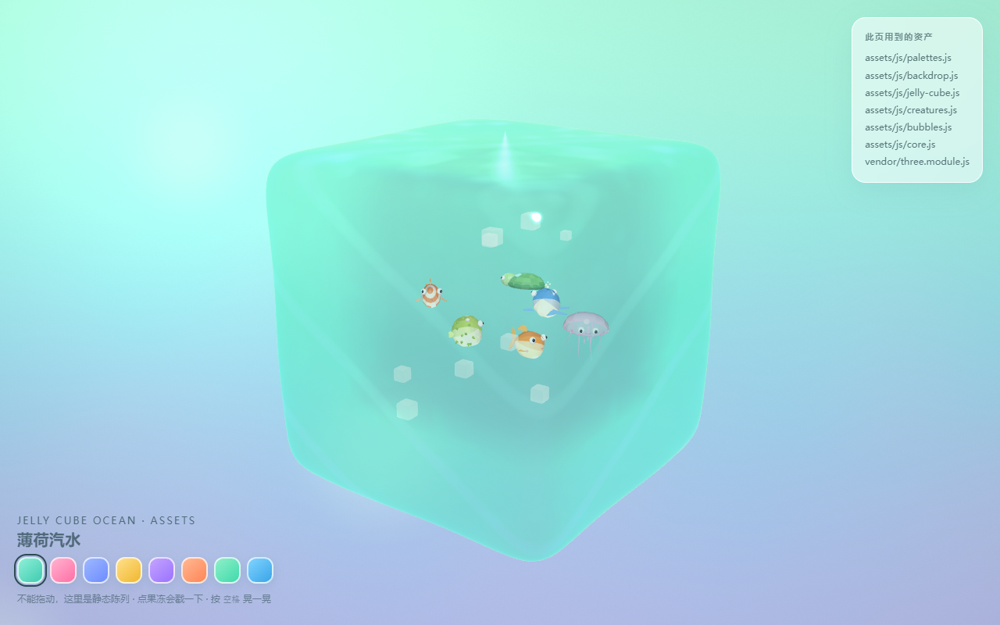

# 果冻方块海洋 · Jelly Cube Ocean

一块会晃的果冻，里面养着六只低多边形小生物。原来是一个 1.4 MB 的单文件 HTML（three.js 直接内嵌），现在把里面的美术部分拆成了可以单独拿走的资产。



**在线**：[资产陈列室](https://mlkgrnt.github.io/jelly-cube-ocean/demo/) · [单文件版](https://mlkgrnt.github.io/jelly-cube-ocean/jelly-cube-ocean.html)

## 两种打开方式

**① 单文件版**（零依赖，双击就玩）

```
jelly-cube-ocean.html
```

three.js、样式、脚本全在一个文件里，离线可用。这是原始版本，没动过。

**② 资产陈列室**（验证拆出来的资产真的能用）

```bash
python -m http.server 8000
# 打开 http://127.0.0.1:8000/demo/
```

ES module 不能走 `file://`，所以需要起个本地服务。陈列室里可以切 8 套配色、点果冻戳一下、按空格晃一晃。

## 资产清单

| 路径 | 内容 |
| --- | --- |
| `assets/js/creatures.js` | 六只生物（小金鱼 / 小丑鱼 / 小水母 / 小鲸鱼 / 小河豚 / 小海龟）+ 兜底生物。纯程序化几何，零贴图 |
| `assets/js/jelly-cube.js` | 超椭球果冻几何、前后双壳糖果材质（Beer-Lambert 厚度吸收 + 屏幕坐标折射 + 菲涅尔 + 焦散）、`JellyBody` 弹簧物理 |
| `assets/js/bubbles.js` | 肥皂泡材质，果冻里的气泡和外面的果冻滴都用它 |
| `assets/js/backdrop.js` | 全屏 fbm 渐变天空 |
| `assets/js/palettes.js` | 8 套配色 + 6 个物种元数据（设计 token） |
| `assets/js/core.js` | 数学 / 配色 / 可复现随机数小工具，零依赖 |
| `assets/glsl/*.glsl` | 上面几个材质的裸 shader，可直接贴进 shadertoy 或其他引擎 |
| `assets/css/jelly-ui.css` | 玻璃拟态控制面板外壳（桌面右上卡片 / 移动端底部抽屉） |
| `assets/svg/jelly-cube.svg` | 果冻方块图标（原 favicon） |
| `assets/json/palettes.json` | 同一份配色的 JSON 版，给非 JS 侧用 |
| `vendor/three.module.js` | three.js r169（MIT），从单文件里原样取出，供 demo 用 |

每个文件的导出、用法见 [`assets/README.md`](assets/README.md)。

## 最快上手

```js
import * as THREE from 'three';
import { getPalette } from './assets/js/palettes.js';
import { JellyBody } from './assets/js/jelly-cube.js';
import { CREATURE_BUILDERS } from './assets/js/creatures.js';
import { mulberry32 } from './assets/js/core.js';

const palette = getPalette('mint');
const jelly = new JellyBody(scene, { palette, softness: 0.55, bounce: 0.6, clarity: 0.62 });

// 养一只小金鱼，丢进果冻里
const fish = CREATURE_BUILDERS.goldfish({
  palette,
  tint: new THREE.Color(palette.jelly),
  rng: mulberry32(42),
});
fish.scale.setScalar(0.5);
scene.add(fish);

// 每帧
jelly.update(dt, t);
jelly.updateCamera(camera);
fish.userData.animate?.(t, dt);
```

果冻的折射要采样一张背景纹理，记得每帧用它自己看到的背景把 `uBgTex` 喂饱：

```js
renderer.setRenderTarget(bgRT);
renderer.render(bgScene, bgCam);   // 把 backdrop 材质烘进 RT
renderer.setRenderTarget(null);
jelly.setBackgroundTexture(bgRT.texture);
```

完整可跑的版本在 `demo/index.html`，一百来行。

## 生物资产的坐标约定

`CREATURE_BUILDERS[id](ctx)` 返回 `THREE.Group`：

- 原点居中，约 1 单位长，**鼻子朝 +Z、尾巴朝 -Z**
- `ctx = { palette, tint, rng }`，`rng` 是 seeded 随机 → 同一个种子长同一只鱼
- `group.userData` 上有 `kind` / `speed` / `wobble` / `materials` / `animate(t, dt)` / `tris`
- 全身是「旋转曲面 + 半径剖面 + 逐面上色」，鳍是挤出的细轮廓，眼睛是嵌进表面的球冠，嘴是贴着表面走的小管子

## 重新生成

`assets/` 下的 JS / GLSL / CSS / JSON 都是从单文件里切出来的，不是手抄的：

```bash
python tools/extract_assets.py
```

改单文件版之后跑一遍，资产跟着更新。手写部分的只有 `assets/js/core.js` 和 `demo/`。

## 许可

本仓库代码 MIT（见 [LICENSE](LICENSE)）。`vendor/three.module.js` 是 three.js r169，同样 MIT，版权归 three.js 作者，原始许可头保留在文件里。
